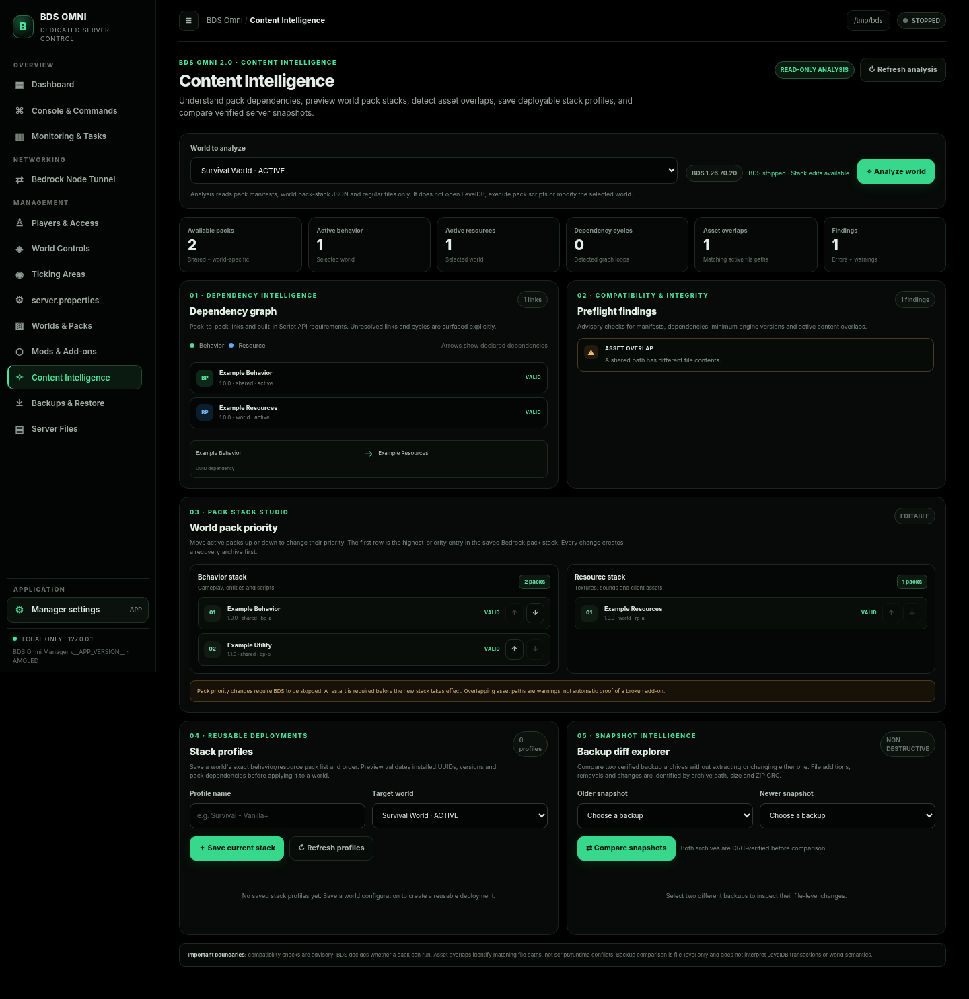
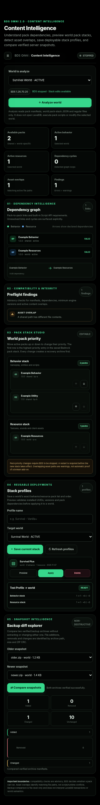

# BDS Omni Manager


**A local-only, AMOLED-black control panel for Minecraft Bedrock Dedicated Server (BDS).** Manage server lifecycle, commands, properties, worlds, Bedrock add-ons, backups, monitoring, scheduled tasks, and the BedrockNodeTunnel Linux user service from one browser interface.

> **Security boundary:** the web interface binds to `127.0.0.1` and is intended for local use. Do not expose it to a LAN, reverse proxy, public tunnel, or the internet.

## 2.0.0 screenshots

**Content Intelligence — desktop**



**Content Intelligence — mobile**



## Quick start

Requirements: Linux, Python 3.11 or newer, a modern browser, and a Linux BDS installation for server-management features. The manager itself uses only the Python standard library; no `pip install` step is required.

```bash
./install.sh
```

Then launch **BDS Omni Manager** from your application menu. For a portable run without installing:

```bash
./run.sh
```

Open the manager's **Settings** page and select the folder containing both `bedrock_server` and `server.properties`. Keep the terminal running while you use the manager. See [First-time setup](#first-time-setup) and [Important process-control boundary](#important-process-control-boundary) below before starting a server.

## Project resources

- [Full feature list and limitations](#what-it-manages)
- [Architecture overview](docs/ARCHITECTURE.md)
- [Notices and trademarks](NOTICE.md)
- [Accessibility](ACCESSIBILITY.md)
- [Contributing](CONTRIBUTING.md)
- [Security policy](SECURITY.md)
- [Support](SUPPORT.md)
- [Changelog](CHANGELOG.md)
- [GitHub launch and release guide](GITHUB_LAUNCH_GUIDE.md)
- [2.0.0 release notes](RELEASE_NOTES_v2.0.0.md)

---

**Version 2.0.0** — Content Intelligence: world-aware pack dependency graphs, dependency-cycle detection, manifest/engine compatibility advisories, cross-pack asset-overlap hashing, safe behavior/resource stack reordering, portable world-specific stack profiles with preview/apply validation, and verified backup snapshot comparison.

**Version 1.9.0** — Mods & Add-ons: a dedicated Bedrock add-on library for behavior packs, resource packs and Script API modules; single `.mcpack`, multi-pack `.mcaddon` and supported ZIP imports; shared or world-specific installation; manifest/dependency inspection; per-world activation; export; and archive-first safe removal with rollback/quarantine recovery.

**Version 1.8.0** — World & Content Management: world library, `.mcworld` import/export, world creation/duplication/rename/switch/archive-delete, behavior/resource pack inspection, per-world activation, dependency validation, and hardened archive handling.

**Version 1.7.0** — Monitoring & Tasks: Linux host and managed-BDS process metrics, historical charts, advisory health checks, local-time scheduled world/full backups and in-game announcements, run history, and safe scheduler shutdown that lets active live backups finish before BDS exits.

**Version 1.6.0** — dedicated Bedrock Node Tunnel integration for the upstream `nethernet-client` Linux systemd user service, with service lifecycle controls, current-session connection health, safe token-file checks, networking diagnostics, and reviewed `server.properties` import.

**Version 1.5.0** — redesigned AMOLED Command Studio, consistent styling for all guided controls, responsive command forms, safer preview invalidation, and asynchronous request-race protection.

**Version 1.3.1** — HTTP browser-disconnect handling, preserving the 1.3.0 interface and path-editor fixes.

A local, AMOLED-black control panel for Minecraft Bedrock Dedicated Server (BDS), designed for Linux/Arch Linux.

## What's new in 2.0.0 — Content Intelligence

- **World-aware dependency graph:** inspect behavior/resource pack nodes, UUID dependency edges, cycles, missing/ambiguous dependencies, malformed manifests, and minimum-engine-version advisories for one selected world. The graph respects Bedrock shared server pack folders and that world's own pack folders; it does not accidentally resolve a pack installed only in a different world. The graph is an inventory/manifest view, not a runtime load trace.
- **Dependency and compatibility preflight:** profile previews report missing packs, duplicate UUID ambiguity, dependency cycles, and version/engine warnings before any stack mutation. Unknown server versions are treated as unknown/advisory, not as a false compatibility pass or a false failure.
- **Cross-pack asset-overlap scan:** compare relative asset paths between active behavior/resource packs and hash eligible regular files to identify exact duplicates and same-path/different-content overlaps. The scan is deliberately bounded to 20,000 files or 350 MiB of candidate file data; individual files over 16 MiB are not hashed. Findings are advisory because a path collision is not by itself proof of a runtime conflict. The scanner does not execute scripts or inspect LevelDB.
- **World pack-stack studio:** reorder the selected world's behavior and resource pack reference lists with move-up/move-down controls. BDS pack priority follows the order represented by the world's stack file; the page explains the top-of-list priority convention. Stack edits require the manager to confirm that BDS is stopped, validate the requested exact permutation, and create a verified recovery archive before writing. Restart BDS for changes to take effect.
- **Portable stack profiles:** save named behavior/resource stack profiles for a world, preview them against another world's visible shared and world-local packs, validate UUID resolution and dependency closure, and apply only after a successful preview. Profile storage is separate from the BDS world and is retained across application upgrades. Applying a profile is a stopped-server operation with a verified pre-change recovery archive and rollback on failed file writes.
- **Verified backup comparison:** compare two existing backup ZIPs after verifying each archive's CRC. The comparison is path-based and reports added, removed, changed and unchanged files using uncompressed size and CRC32 metadata. Archives are not extracted, and this feature does not inspect/compare the internal contents of LevelDB databases. Results are bounded for display.
- **Safety boundaries:** stack/profile mutations are disabled while managed or external BDS is running. Recovery archives are written only to a configured backup directory outside the server root; symlinked or unsafe destinations are rejected. Existing pack manifests and stack files are preserved unless the user explicitly previews and applies a change.
- **AMOLED UI:** adds an explicitly styled Content Intelligence workspace with world selector, summary metrics, dependency graph, issue cards, pack-stack controls, profile actions, backup comparison, disabled/loading/error states, keyboard focus and responsive layouts.
- **Scope:** this release provides static manifest/stack intelligence and file-level overlap detection. It is not a Bedrock runtime profiler, does not execute add-on scripts, does not modify LevelDB, and cannot guarantee runtime compatibility where packs depend on game behavior that cannot be inferred from manifests.

## What's new in 1.9.0 — Mods & Add-ons

- **Dedicated Mods & Add-ons page:** one inventory for server-shared and world-specific Bedrock packs, with search by name/UUID/author/module, filters by behavior/resource/script type and validation state, summary counts, per-pack metadata, active-world references, and a selected-world activation view.
- **Bedrock-native meaning of “mods”:** this section manages Bedrock add-ons—behavior packs, resource packs and Script API modules packaged inside behavior packs. Java Edition `.jar` mods and Forge/Fabric loaders are not compatible with BDS and are explicitly rejected rather than treated as installable content.
- **Single-pack import:** install `.mcpack` files or ZIP archives containing one valid pack. A ZIP may contain a root `manifest.json` or one wrapper folder around the pack.
- **Multi-pack `.mcaddon` import:** validate every nested `.mcpack` before installing any of them. All pack UUIDs, module UUIDs, manifests, dependencies, archive paths, CRCs, expanded sizes and destination collisions are checked before commit. Pack folder moves are committed as a bundle and rolled back if a later move fails. Imported packs are not automatically activated in a world.
- **World bundle boundary:** `.mcaddon` is a ZIP-based container format that may contain `.mcpack` or `.mcworld` content. This Mods importer deliberately rejects a bundle that contains a `.mcworld` rather than silently dropping its world component; import the world separately through Worlds & Packs. See [Microsoft's official file-extension reference](https://learn.microsoft.com/en-us/minecraft/creator/documents/bedrockserver/file-extensions?view=minecraft-bedrock-stable).
- **Shared or world-specific scope:** install add-ons in the server's shared `behavior_packs/` or `resource_packs/` directories, or into one selected world's corresponding directories. Existing world folders are never overwritten during import.
- **Manifest and dependency inspection:** view pack/header/module UUIDs and versions, module types, minimum engine version, authors, license, capabilities, dependencies, scope, size, active worlds, duplicate UUIDs and validation errors. Script modules are identified distinctly in the library.
- **Per-world activation:** update the selected world's `world_behavior_packs.json` or `world_resource_packs.json` with validated pack references. Valid UUID-based pack dependencies are included. BDS must be stopped before activation changes and restarted before the updated stack takes effect.
- **Ambiguity protection:** duplicate pack UUIDs are reported and cannot be activated, deactivated or removed through an ambiguous location. Invalid packs cannot be newly enabled; an already-active invalid reference may still be switched off when the target is unambiguous.
- **Export and safe removal:** export an individual pack as `.mcpack`. Removal first creates a CRC-verified recovery archive, validates all affected world-reference files, and moves the pack to an atomic same-parent quarantine before changing references. If an update fails, the original folder and references are restored; if final quarantine cleanup fails, the hidden recovery folder and verified archive are retained and reported.
- **Archive protections:** import staging rejects path traversal, absolute/Windows-drive paths, case-insensitive duplicate paths, symlinks/special files, encrypted entries, unsupported compression and CRC errors. The upload limit is 8 GiB, expanded data is limited to 32 GiB across the complete `.mcaddon` bundle, and archive entry count is limited to 150,000. Export applies corresponding size/entry bounds.
- **Mutation boundary:** pack installation, activation and removal are blocked while managed or detected external BDS is running. The manager does not edit pack script contents or rewrite binary assets; it installs validated archives as-is.
- **AMOLED UI:** dedicated styles for the Mods import area, pack inventory, filters, stats, status badges, metadata, dependencies, warnings, activation controls, disabled states and mobile layouts. Mutation controls remain disabled until server state is known and BDS is confirmed stopped.
- **Regression coverage:** includes nested and invalid `.mcaddon` bundles, atomic rollback, combined expanded-size limits, `.mcworld` bundle rejection, `.jar` rejection, ZIP wrapper imports, duplicate UUID ambiguity, script-pack classification, dependency validation, safe removal/quarantine, authenticated uploads, and Chromium desktop/mobile interactions.

## What's new in 1.8.0 — World & Content Management

- **World library:** inspect the directories under the selected server's `worlds/` folder, active `level-name`, display name, storage size, file count, behavior/resource reference counts, modification time, and integrity notes. The manager does not parse or modify LevelDB files or binary `level.dat` data.
- **World import/export:** import `.mcworld` or ZIP archives containing a Bedrock world. Accepts a world at the archive root or inside one wrapper folder. Export writes the contents of the selected world at the archive root so the result is suitable for `.mcworld` import. Every export is CRC-checked before it is published.
- **World actions:** select a new empty world (BDS generates its files at next startup), duplicate a world into a separate folder, rename a folder and update `level-name` when it is the active world, switch the active world, or archive and delete an inactive world. Deletion first creates a verified `.mcworld` recovery archive and atomically moves the source into a hidden quarantine; if cleanup fails, the manager attempts to restore the complete world from the verified archive and retains the quarantine for manual recovery.
- **Pack installation:** import single behavior or resource packs from `.mcpack` or ZIP archives. The manifest determines the pack type. Install into shared server-level pack folders or into one selected world's pack folder. Multi-pack `.mcaddon` bundle import is added in 1.9.0 and is validated/committed as one transaction; bundles containing a `.mcworld` are rejected by the Mods importer so the world can be imported separately.
- **Pack inspection:** inspect `manifest.json`, header and module UUIDs, versions, module types, `min_engine_version`, dependencies, scope, size, active world references, duplicate UUIDs, missing dependencies, and malformed manifests. Manifest format version 3 is shown as preview-only and cannot be activated through the stable workflow.
- **Per-world pack stacks:** enable or disable installed behavior/resource packs for an individual world by updating its `world_behavior_packs.json` and `world_resource_packs.json` files. Valid UUID-based dependencies are checked and automatically activated. Invalid packs cannot be newly enabled; an already-active invalid pack can still be disabled to let the world stop referencing it. BDS must be stopped for pack-stack changes and restarted before they take effect.
- **Pack export/removal:** export individual packs as root-level `.mcpack` archives. Removal first creates a verified recovery archive and removes matching world references; packs with duplicate UUIDs or active dependents are blocked from ambiguous/destructive removal.
- **Archive safety:** imports are staged and CRC-checked before installation. The archive reader rejects path traversal, absolute/Windows drive paths, duplicate case-insensitive paths, symlinks/special files, encrypted archives, and unsupported compression methods. Per-upload size is capped at 8 GiB, expanded data at 32 GiB, and archive entries at 150,000. Exports use the same expanded-size and entry-count bounds. Archive paths are never extracted directly over an existing world or pack.
- **Mutation boundary:** world/pack changes are blocked when a managed or detected external BDS process is running. Choose a backup destination outside the BDS directory. Existing worlds are not overwritten during import. World and pack exports are stored outside the BDS server directory.
- **AMOLED styling:** added explicit responsive styles for all world/pack forms, file inputs, metrics, library cards, status pills, world-detail controls, error messages, and disabled/invalid pack states. Invalid packs are visibly blocked from activation; active invalid packs retain an off action.
- **Regression coverage:** includes archive path and CRC attacks, import/export round trips, duplicate and invalid manifests, pack dependency scope, duplicate UUIDs, active pack dependencies, world rename rollback, failed world-deletion recovery, HTTP authentication and uploads, download tickets, UI control styling, and mobile layout.

## What's new in 1.7.0 — Monitoring & Tasks

- **Host monitoring:** sample aggregate CPU utilization, memory, non-loopback network throughput, and disk capacity for the server and backup destinations from Linux `/proc` and filesystem APIs. Values are sampled every five seconds and retained as a bounded in-memory history for the live charts.
- **Managed BDS process metrics:** show the manager-launched BDS process RSS, virtual memory, threads, file descriptors, and sampled CPU utilization when the process is available. These are not fabricated for externally launched processes; unavailable values remain unavailable.
- **Advisory health checks:** inspect the selected executable and `server.properties`, managed or externally detected process state, server disk free space, backup destination writability, and recent error-like log lines. A stopped BDS process is informational, not a fault; an externally launched BDS process is identified by PID and clearly marked as unmanaged. Health status is diagnostic guidance, not a guarantee that a world is healthy.
- **Scheduled tasks:** create, edit, pause/resume, and delete up to 40 tasks. Supported task types are world backups, full-server backups, and in-game `say` announcements. Choose a local 24-hour time and one or more weekdays.
- **Run history:** record success/failure, start and finish times, and a concise result for the latest 50 task runs. Task definitions and history are stored separately from the manager's main configuration at `~/.local/state/bds-omni-manager/scheduled_jobs.json`.
- **Missed-run policy:** tasks execute only while BDS Omni Manager is running and only within 150 seconds of the configured local time on a selected weekday. Missed tasks are skipped; they are not replayed after the machine sleeps, the manager is closed, or the system reboots. Times use the host's local timezone.
- **Safe live-backup shutdown:** when the manager exits, it stops scheduling new tasks and waits for active scheduled/automatic backup work to finish and release BDS `save hold` with `save resume` before asking its managed BDS process to stop. This can make shutdown take as long as an in-progress backup.
- **Scope and limitations:** host CPU/memory/network include activity from other applications and services. BDS process metrics are available only for a process launched by this manager. The UI does not claim a TPS value because BDS does not expose a reliable universal TPS metric through this manager's current interface. Announcement tasks require a running BDS process managed by this application; backup operations retain the existing backup safety checks and can fail rather than copy a live world unsafely.
- **AMOLED UI:** explicit styles for metric cards, charts, health rows, schedule form controls, weekday toggles, status indicators, empty states, and mobile layouts. Monitoring polls only while its page is active and the browser tab is visible.
- **Security:** monitoring and schedule APIs use the same per-launch local API token as the rest of the manager. Scheduled task types are allow-listed; the scheduler does not execute arbitrary shell commands.
- **Regression coverage:** includes `/proc` parsing and metric calculations, health checks, schedule validation and persistence, success/failure recording, HTTP authentication, local weekday/time-window behavior, missed-run policy, scheduler worker-start failure handling, invalid saved-task ID handling, and shutdown waiting for active work.

## What's new in 1.6.0 — Bedrock Node Tunnel integration


- **Upstream service control:** detect and manage the documented `bedrocknode-tunnel.service` systemd user unit with Start, Stop, Restart, Enable at login, and Disable at login actions. The manager does not install, replace, or edit the upstream unit.
- **Client discovery and version:** detect `nethernet-client`, prefer the exact executable path reported by the service's `ExecStart`, and run only its documented `-version` flag. The version source is shown in status data.
- **Connection health, not just process health:** distinguish a running service from an authenticated tunnel. Connection events are read only from the current systemd `InvocationID`; when the current invocation cannot be identified, the manager refuses to infer “connected” from historical journal lines.
- **Safe token checks:** detect the upstream token file in the XDG config location and relevant service working-directory fallback locations, and report file permissions. Token contents and `-token` command-line values are never read, returned, or logged by this manager.
- **Repeated UDP mapping editor:** `server-udp-ports` uses a dedicated dark multiline editor. Each mapping remains on its own `server-udp-ports=` line through reload, edit, save, backup, and Bedrock Node import. Up to 32 entries are accepted per save/import; blank lines are ignored. Other duplicate properties remain rejected by the dashboard importer. The manager preserves the mapping text exactly instead of trying to reinterpret ranges or public/local port pairs, because behavior varies by BDS build. Mojang's issue tracker has an **unconfirmed** report documenting separate repeated rows as a workaround on affected builds: [BDS-23126](https://bugs.mojang.com/browse/BDS-23126). Check the `bedrock_server_how_to.html` bundled with your exact BDS version before changing live mappings.
- **Networking diagnostics:** show the configured local TCP target, local UDP target, BDS `transport`, bind address, TCP port, UDP mapping presence, and a local TCP reachability probe. The panel does not invent the account-specific public endpoint or UDP mappings.
- **Reviewed networking import:** paste the exact network-related `key=value` lines from the Bedrock Node dashboard, preview the property diff, and explicitly apply it. Unrelated properties, duplicate scalar keys, malformed values, and non-NetherNet transport are rejected. Repeated `server-udp-ports` entries are preserved as separate mappings rather than collapsed into one value.
- **Optional lifecycle linking:** optionally request tunnel start after BDS start and tunnel stop before a manager-owned BDS stop. Failures are surfaced in the API response and manager log; BDS stop/restart still proceeds.
- **Safer diagnostics:** current-session claim/re-claim states are recognized, token values are never exposed, and the service executable's version is not confused with the BDS version.
- **Regression coverage:** added tests for invocation-scoped journal health, invalid-token claim state, executable discovery, XDG fallback behavior, and lifecycle failure reporting.

### Install BedrockNodeTunnel separately

The tunnel client is a separate upstream project. On Arch Linux, follow its official release instructions and install its `PKGBUILD` with `makepkg -si`. Then run `nethernet-client` once to complete the browser claim flow and allow it to save its token. In BDS Omni Manager, use **Bedrock Node Tunnel → Start tunnel** to start the installed user service and **Enable at login** if you want systemd to start that service with your user session.

Copy the exact four networking lines shown in your Bedrock Node dashboard into the manager's **Import dashboard networking settings** field. Review the diff and apply it, then restart BDS. The assigned public IP/port shown on the Bedrock Node dashboard may differ from the local BDS `server-port`; share the public endpoint shown by that dashboard with players, not a guessed port.

To keep the systemd *user* service available after logout or before an interactive login, the upstream documentation mentions enabling lingering with `loginctl enable-linger "$USER"`. This is an optional operating-system setting; the manager does not change it. Lingering the tunnel service does not make the BDS process itself a boot service.

Official project references: [BedrockNodeTunnel GitHub](https://github.com/NotAlive24/BedrockNodeTunnel), [Bedrock Node dashboard](https://bedrocknode.net/). The upstream Linux client documents `-version`, `-local-http`, `-local-udp-ip`, `-local-udp-port`, token claiming, and the `bedrocknode-tunnel.service` user unit.

## What's new in 1.5.0

- **Command Studio visual redesign:** the operation picker and operation details now have their own header panel, with command arguments arranged in a balanced responsive grid beneath them.
- **Consistent control styling:** all generated text, number, select, boolean and multiline controls have explicit AMOLED backgrounds, readable text, borders, placeholders, focus styles, and responsive sizing. This fixes the native grey controls visible in the previous release.
- **Clearer guidance:** each operation shows its category, description, cheats/Game Director hint, confirmation requirement, required markers, field count, and optional help text.
- **Safer preview lifecycle:** required/range validation runs before the server-side preview request. Any form edit invalidates the prior preview; preview results are tied to their original form and arguments, so a stale command cannot be sent after editing.
- **Async race protection:** changing fields or switching operations while a preview request is in flight invalidates that response and restores the Preview button.
- **Accessibility and responsive polish:** explicit labels, live status regions, keyboard focus styles, and a single-column form layout on narrow screens.

The Command Studio currently includes 27 guided operations. The raw console remains available for every command supported by the installed BDS build.

## What's new in 1.4.0

- **Command Studio:** 27 guided forms for common player, world, entity, communication, and world-editing operations. The raw console remains available for any command supported by the installed BDS build.
- **Preview before execution:** guided forms call a server-side validator and show the exact command before sending. Destructive or high-impact actions require an additional confirmation.
- **Input validation:** targets/selectors, coordinates, identifiers, message text, enumerated values, and numeric ranges are checked server-side. The command preview does not execute anything.
- **More world tools:** guided clone-region, fill, setblock, summon, spawn controls, game rules, time, weather, and mob-event controls.
- **More player tools:** guided game mode, teleport, give, clear, effects, experience points, tags, OP/de-OP, kick, and clear-spawnpoint operations.
- **Searchable properties:** filter the property editor by label, key, or description without dropping the current form values.
- **Installed-server help:** one-click `/help` query sends the request to the running BDS console. The installed server's own help output is the final authority for command availability and syntax.
- **Correct weather units:** the weather duration field is labelled in game ticks (20 ticks ≈ 1 second).
- **HTTP stability:** retains the 1.3.1 handling for browsers that close an in-flight connection.

The 27 guided forms are a convenience layer, not a claim that every command has a custom form. The searchable command index and raw console remain the universal access path. Forms may still be unavailable on older BDS versions or require cheats, experiments, and specific permission levels. Confirm command availability with `/help` on the actual server.

## What it manages

| Area | Included controls |
|---|---|
| Server lifecycle | Start, graceful stop, restart, process/PID/uptime status, output log, process detection to avoid opening the same world twice |
| Console | Send any single-line BDS console command; live output; searchable built-in command index; `/help` shortcut; Command Studio with 27 server-validated guided forms, responsive OLED styling, and preview/confirmation |
| Bedrock Node Tunnel | Detect and control upstream `bedrocknode-tunnel.service`; inspect `nethernet-client` version; current-session authenticated health; local TCP/UDP target diagnostics; token presence/permission checks without reading token contents; reviewed import of account-specific BDS networking settings; optional BDS start/stop linking |
| Ticking areas | Add circle/rectangle, name areas, preload/un-preload, list across dimensions, remove by name/position, remove all |
| World controls | Game mode, difficulty, time, weather, daylock, gamerules, mob events, world spawn, player spawn, save hold/query/resume |
| Players & access | Online players observed in logs, `/list`, OP/de-OP/kick shortcuts, edit `allowlist.json` and `permissions.json` |
| Properties | Typed controls for 55 documented property fields, searchable by label/key/help, including a masked script-debugger passcode field, plus editing of unknown/newer keys from the actual file; preserves comment lines and makes a one-time original-file copy |
| Worlds & packs | World library, `.mcworld` import/export, create/duplicate/rename/switch/archive-delete, behavior/resource pack import/export/inspection/removal, per-world pack stacks, dependency/UUID/manifest validation |
| Backups | Active-world archive, full-server archive, automatic world backups (1/3/6/12/24/48 hours), retention, stopped-server restore |
| Files | Read-only browser for the selected BDS directory |
| Settings | Select the BDS root and backup destination, set auto-backup cadence and retention |

The dashboard server-version card is based on the current BDS executable's own startup log, not on the manager version or the historical manager log. If the selected BDS binary has never been started through this manager, the dashboard intentionally reports `Unknown` until a version banner is captured. A cached value is reused only while the exact executable fingerprint remains unchanged. The app cannot inspect the console of a server started externally; for an uncached external process, `Unknown` is intentional rather than a guessed or stale version.

The console remains the universal access path for commands which do not have their own guided screen. This matters because BDS command syntax is large, some commands are added/changed by game releases, and some commands require experiments, cheats, or a particular permission level. The searchable 82-command catalogue is based on Microsoft's stable command index as of this build; the input accepts any command your installed server supports, including newer or add-on commands. Not every command has a bespoke parameter form in this release: 27 guided forms cover common workflows, while the raw console handles commands supported by your installed server.

## UI and folder path entry (1.3.0)

The interface is AMOLED-black only. Navigation is compact and the Application/Settings destination is pinned below the scrollable navigation list. The layout adapts to laptop and smaller browser widths, uses consistent panel spacing, and respects reduced-motion preferences.

Server and backup folder fields accept normal typing and paste. A background status refresh will not replace an unsaved draft; failed saves keep the draft visible, and Reset restores the currently saved path. The **Browse…** button opens a native Linux directory chooser when one of `zenity`, `kdialog`, or `yad` is installed. The chooser only selects a path; you must still press Save. If none of those tools is available, install one (for example, `sudo pacman -S zenity` on Arch) or paste/type the path manually.

## Install on Arch Linux

1. Extract the project archive.
2. In a terminal, enter the extracted folder.
3. Run:

   ```bash
   ./install.sh
   ```

4. Launch **BDS Omni Manager** from your application menu, or run:

   ```bash
   ~/.local/share/bds-omni-manager/run.sh
   ```

The installer creates a desktop entry under `~/.local/share/applications/`. The application uses your default browser for the dashboard. The terminal hosting the manager must remain open while you use it.

For a portable run without installing:

```bash
./run.sh
```

Requirements: Python 3.11 or newer, a modern browser, and the official Linux BDS folder. On Arch, Python is normally already installed; if not, install it with `sudo pacman -S python`.

## First-time setup

1. Open **Settings**.
2. Set **Server folder path** to the directory containing both `bedrock_server` and `server.properties`.
3. Save it. If the executable is not marked executable, run this in a terminal:

   ```bash
   chmod +x "/path/to/bedrock-server/bedrock_server"
   ```

4. Return to Dashboard and start the server.

The manager runs the official Linux `bedrock_server` executable from its own folder and adds that folder to `LD_LIBRARY_PATH` so bundled libraries can be found.

## Important process-control boundary

The manager can send commands and read output only for the BDS process it starts itself. It cannot safely attach to a server already launched by a separate terminal, `systemd`, `tmux`, Docker, or a wrapper such as an existing `mcserver` script. BDS does not provide a general-purpose remote console interface for this app to attach to.

If you currently run BDS through an existing `mcserver`/WaterdogPE/Playit setup:

- Stop the existing BDS instance using its existing management method first.
- Point this app at the folder that contains the actual `bedrock_server` binary and `server.properties` (not the WaterdogPE folder or the wrapper script).
- Do not start two BDS processes against the same world folder.

An external BDS process is detected where possible and blocks a second launch. This release manages **BDS itself** and the specific upstream BedrockNodeTunnel `systemd --user` service. It does not control WaterdogPE, Playit, Endstone, or other proxy/plugin services.

Closing the browser tab does not stop the manager or BDS. Pressing `Ctrl+C` in the manager terminal gracefully stops the BDS process owned by the manager, then exits.

## Backup safety

Live BDS world backups must not simply copy a LevelDB folder while the server is writing to it. This manager uses the BDS save workflow:

1. Send `save hold`.
2. Repeatedly send `save query` until BDS says `Data saved. Files are now ready to be copied.`
3. Parse the manifest returned by BDS and copy only those paths, truncating each archive entry to the exact byte length BDS reported.
4. Send `save resume` even if the backup fails after the hold.

If BDS does not provide a ready manifest, the manager refuses to create a live world snapshot instead of silently copying a potentially inconsistent database. When BDS is stopped, the selected world/full folder is archived normally. Backups are ZIP64 archives and include metadata identifying the backup type. The manager CRC-checks a new archive before publishing it and offers a Verify action for stored archives. Restore is allowed only when no managed or detected external BDS process is running. It verifies and stages the archive before applying any files, and retains rollback data until the restore completes. A **world snapshot restore replaces the archived world's matching folder** and restores the snapshot's shared server/access/pack files. A **full-server restore overlays matching paths** and leaves unrelated files that are not present in the archive untouched. Create a current full backup first when you need to retain the pre-restore state.

Choose a backup directory **outside** the BDS server folder. Automatic backups are world backups, not full binary/server snapshots. Retention deletes the oldest `BDS-*.zip` archives in the configured destination.

## What this release does not claim to do

This is a substantial administration tool, not a wrapper around every BDS subsystem. It does **not** provide a bespoke form for every possible argument combination of every command, remote administration, multiple simultaneous server profiles, BDS binary auto-updates, automatic Marketplace downloads, direct editing of LevelDB or binary `level.dat` data, arbitrary execution of pack scripts from the manager, or controls for third-party proxy/plugin processes other than the documented BedrockNodeTunnel user service. Mods & Add-ons manages native Bedrock behavior/resource/script packs; it does not install Java `.jar` mods. The Mods importer rejects `.mcaddon` bundles that also contain a `.mcworld`; import that world separately through Worlds & Packs. The Bedrock Node integration does not install/update the client, manage your Bedrock Node account, read the account dashboard, reset claims, or expose the token. Use the command console for the full BDS command surface; the file browser is intentionally read-only.

World and pack operations are file-level management tools. The manager validates archive structure and manifest metadata, but it cannot prove that arbitrary pack scripts are runtime-compatible with every BDS build or guarantee that a world will load successfully after an import. It deliberately does not edit LevelDB contents or binary world metadata. Test imported content on a copy before making it your primary world. BDS remains authoritative when it loads a world and its pack stack.

All in-game command operations remain subject to the permissions, cheats, experiments, and syntax of the exact BDS build in use. The command catalogue and property schema may need updating as Microsoft adds or changes commands/properties. Existing unrecognized `server.properties` keys remain visible and editable as strings.

## Data locations

- Manager config: `~/.config/bds-omni-manager/config.json`
- Manager log: `~/.local/state/bds-omni-manager/manager.log`
- Default backups: `~/BDS-Backups/`
- Installed app: `~/.local/share/bds-omni-manager/`
- Upstream BedrockNodeTunnel token (manager checks presence/permissions only): `$XDG_CONFIG_HOME/bedrocknode-tunnel/bedrocknode-token.txt` or `~/.config/bedrocknode-tunnel/bedrocknode-token.txt`

## References

Command form syntax is cross-checked against the official Bedrock command references, including [`/effect`](https://learn.microsoft.com/en-us/minecraft/creator/commands/commands/effect?view=minecraft-bedrock-stable), [`/tickingarea`](https://learn.microsoft.com/en-us/minecraft/creator/commands/commands/tickingarea?view=minecraft-bedrock-stable), [`/teleport`](https://learn.microsoft.com/en-us/minecraft/creator/reference/content/commandsreference/examples/commands/teleport?view=minecraft-bedrock-stable), [`/fill`](https://learn.microsoft.com/en-us/minecraft/creator/reference/content/commandsreference/examples/commands/fill?view=minecraft-bedrock-stable), [`/clone`](https://learn.microsoft.com/en-us/minecraft/creator/reference/content/commandsreference/examples/commands/clone?view=minecraft-bedrock-stable), [`/setblock`](https://learn.microsoft.com/en-us/minecraft/creator/reference/content/commandsreference/examples/commands/setblock?view=minecraft-bedrock-stable), [`/give`](https://learn.microsoft.com/en-us/minecraft/creator/reference/content/commandsreference/examples/commands/give?view=minecraft-bedrock-stable), [`/xp`](https://learn.microsoft.com/en-us/minecraft/creator/reference/content/commandsreference/examples/commands/xp?view=minecraft-bedrock-stable), and [`/clear`](https://learn.microsoft.com/en-us/minecraft/creator/reference/content/commandsreference/examples/commands/clear?view=minecraft-bedrock-stable).


- [Microsoft Learn — Getting Started with Bedrock Dedicated Server](https://learn.microsoft.com/en-us/minecraft/creator/documents/bedrockserver/getting-started?view=minecraft-bedrock-stable)
- [Microsoft Learn — Create a World Template from an Exported World](https://learn.microsoft.com/en-us/minecraft/creator/documents/bedrockserver/create-a-world-template?view=minecraft-bedrock-stable)
- [Microsoft Learn — Manifest JSON reference](https://learn.microsoft.com/en-us/minecraft/creator/reference/content/manifestreference/manifestheader?view=minecraft-bedrock-stable)
- [Microsoft Learn — Introduction to Behavior Packs](https://learn.microsoft.com/en-us/minecraft/creator/documents/behaviorpack?view=minecraft-bedrock-stable)
- [Microsoft Learn — Bedrock Dedicated Server Properties](https://learn.microsoft.com/en-us/minecraft/creator/documents/bedrockserver/server-properties?view=minecraft-bedrock-stable)
- [Microsoft Learn — Minecraft Bedrock Commands](https://learn.microsoft.com/en-us/minecraft/creator/commands/commands?view=minecraft-bedrock-stable)
- [Microsoft Learn — `/tickingarea`](https://learn.microsoft.com/en-us/minecraft/creator/commands/commands/tickingarea?view=minecraft-bedrock-stable)
- [Microsoft Learn — `/save`](https://learn.microsoft.com/en-us/minecraft/creator/commands/commands/save?view=minecraft-bedrock-stable)
- [BedrockNodeTunnel — upstream Linux client and Arch installation](https://github.com/NotAlive24/BedrockNodeTunnel)
- [Bedrock Node — account dashboard and public join endpoint](https://bedrocknode.net/)
- [systemd.exec — user service working-directory defaults](https://man7.org/linux/man-pages/man5/systemd.exec.5.html)

## License

MIT. See `LICENSE`.


### 1.3.1 HTTP disconnect handling

If the browser closes, reloads, or navigates away while an HTTP response is in flight, the manager now closes that request quietly. Expected `BrokenPipeError` and connection-reset events no longer produce duplicate tracebacks. Unexpected application errors are still handled normally.
